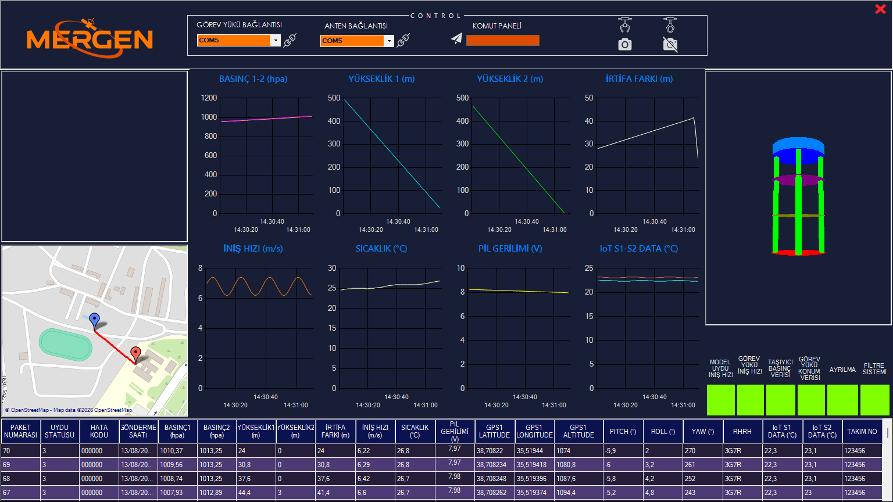
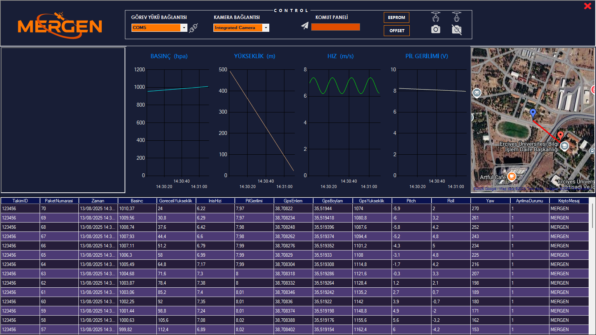
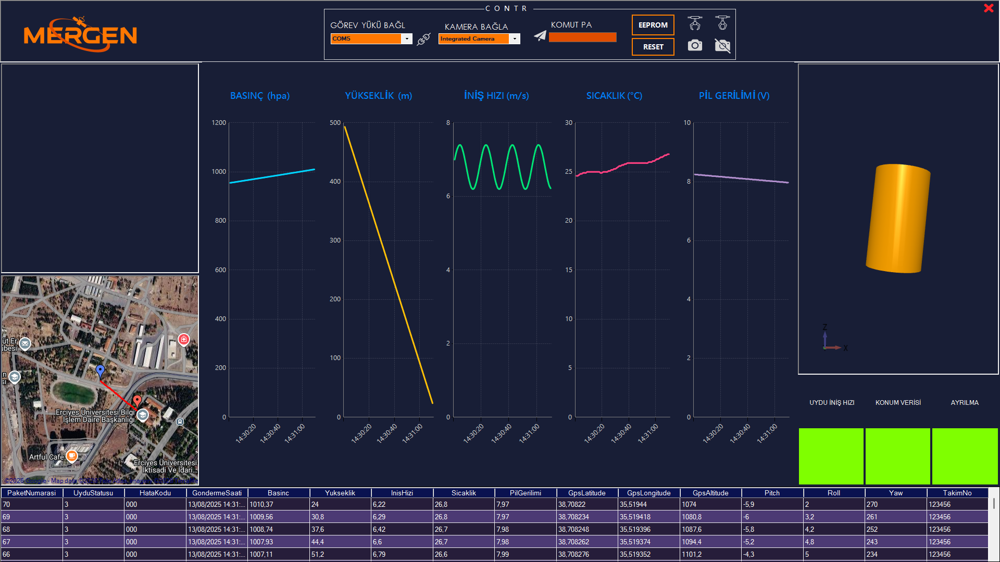

# MERGEN-KAT1-GCSS

MERGEN takımının model uydu ve CubeSat görevleri için geliştirdiği yer istasyonu yazılımı (Ground Control Station Software). Uydudan seri port üzerinden gelen telemetriyi çözer; grafiklerde, tabloda, haritada ve 3B modelde gösterir. Verileri CSV'ye kaydeder, uyduya komut gönderir ve kamera görüntüsünü kaydeder.

C# ve Windows Forms (.NET Framework 4.7.2) ile yazılmıştır.


*TEKNOFEST 2025 Kategori 1 sürümü. Görüntülerdeki değerler örnek veridir.*

## Sürümler

Aynı altyapı farklı yarışmaların isterlerine göre ayrı branch'lerde geliştirildi. `master` branch'i projenin ilk arayüz tasarımını içerir. Tamamlanmış sürümler şunlardır:

| Branch | Görev | Telemetri paketi |
|---|---|---|
| [`KAT1-YİST`](../../tree/KAT1-Y%C4%B0ST) | TEKNOFEST 2025 Model Uydu Yarışması, Kategori 1 | 22 alan, `*` ile ayrılmış |
| [`AZ`](../../tree/AZ) | Azerbaycan CubeSat yarışması | 15 alan, `,` ile ayrılmış |
| [`T3`](../../tree/T3) | T3 Vakfı uydu eğitimi (MERSAT) | 16 alan, `,` ile ayrılmış |

## Ortak özellikler

- **Seri port bağlantısı (9600 baud):**
  - Okuma ve işleme ayrı iş parçacıklarında (thread) çalışır, arayüz donmaz.
  - Paketler `$` ile başlar, `#` ile biter. Bozuk ya da yarım paketler atılır, tampon taşarsa temizlenir.
- **Grafikler ve kayıt:** telemetri zaman grafiklerinde gösterilir. Her paket tabloya eklenir ve masaüstündeki bir CSV dosyasına yazılır.
- **Harita:** GMap.NET ile uydunun konumu ve izlediği yol çizilir; geçersiz koordinatlar yok sayılır.
- **Komut paneli:**
  - Uyduya mesaj gönderme (`C` + mesaj).
  - Kilitleme / kilit açma komutları (`B` / `A`).
- **Kamera:** canlı görüntü ve masaüstüne MP4 olarak otomatik kayıt (AForge / Accord).

## Sürümlere göre farklar

### TEKNOFEST 2025, Kategori 1 (`KAT1-YİST`)
- **Telemetri:**
  - Paket numarası, uydu statüsü, hata kodu, gönderme saati.
  - Görev yükü ve taşıyıcının basınç ve yükseklikleri, irtifa farkı, iniş hızı.
  - Sıcaklık, pil gerilimi, GPS, pitch / roll / yaw, RHRH, IoT S1–S2, takım no.
- **Grafikler:** 8 zaman grafiği. Kayıt dosyası `TELEMETRİ.csv`. Harita OpenStreetMap.
- **3B simülasyon:** OpenTK ile uydu modeli gelen açılarla döner. Ayrılma gerçekleşince model değişir (hata kodunun 5. biti).
- **ARAS (arıza tespit) göstergesi:** hata kodunun her biti bir ışık. Hata olan bit kırmızı yanar ve sesli uyarı verilir.

```
$paket*statü*hata_kodu*saat*basınç1*basınç2*yükseklik1*yükseklik2*irtifa_farkı*iniş_hızı*sıcaklık*pil*
 gps_enlem*gps_boylam*gps_yükseklik*pitch*roll*yaw*RHRH*iot_s1*iot_s2*takım_no#
```

### Azerbaycan CubeSat (`AZ`)
- **Telemetri:**
  - Takım ID, paket numarası, zaman.
  - Basınç, göreli yükseklik, iniş hızı, pil gerilimi.
  - GPS, pitch / roll / yaw, ayrılma durumu, şifreli (kripto) mesaj.
- **Grafikler:** 4 grafik (göreli yükseklik, basınç, iniş hızı, pil). Kayıt dosyası `MERGEN.csv`. Harita Google Hybrid.
- **Ek komutlar:** **EEPROM** (`E`) ve **OFFSET** (`R`).
- **Kamera:** bağlı kameralar listelenir, istenen kamera seçilir.



```
$takım_id,paket,zaman,basınç,göreli_yükseklik,iniş_hızı,pil,gps_enlem,gps_boylam,gps_yükseklik,pitch,roll,yaw,ayrılma,kripto_mesaj#
```

### T3 Vakfı, MERSAT (`T3`)
- **Telemetri:**
  - Paket numarası, uydu statüsü, hata kodu, gönderme saati.
  - Basınç, yükseklik, iniş hızı, sıcaklık, pil gerilimi.
  - GPS, pitch / roll / yaw, takım no.
- **Grafikler:** 5 grafik. Kayıt dosyası `TELEMETRİ.csv`. Harita Google Hybrid.
- **3B simülasyon:** HelixToolkit (WPF) ile yeniden yazıldı; açı geçişleri yumuşatılır.
- **ARAS göstergesi.**
- **Ek komutlar:** **EEPROM** (`E`) ve **RESET** (`R`).
- **Kamera:** bağlı kameralar listelenir, istenen kamera seçilir.



```
$paket,statü,hata_kodu,saat,basınç,yükseklik,iniş_hızı,sıcaklık,pil,gps_enlem,gps_boylam,gps_yükseklik,pitch,roll,yaw,takım_no#
```

## Dosyalar (tamamlanmış sürümlerde)

| Dosya | İçerik |
|---|---|
| `Form1.cs` | Ana pencere, port, kamera ve komut düğmeleri |
| `Data.cs` | Seri port okuma, paket ayırma, işleme kuyruğu, komut gönderme |
| `TelemetryData.cs` | Paket ayrıştırıcı |
| `Chart.cs` | Grafikler |
| `DataGridViewHandler.cs` | Tablo ve CSV kaydı |
| `Map.cs` | Harita ve rota |
| `_3DSimulation.cs` | 3B uydu modeli |
| `Aras.cs` | Hata kodu göstergesi |
| `Camera.cs` | Kamera görüntüsü ve kaydı |

## Kurulum ve çalıştırma

**Gerekenler:**
- Windows 10 / 11
- Visual Studio 2019 ya da 2022, ".NET masaüstü geliştirme" iş yüküyle (.NET Framework 4.7.2 dahil)
- Harita için internet bağlantısı
- Kamera görüntüsü için USB kamera (isteğe bağlı)

**Adımlar:**
1. Depoyu indirin ve istediğiniz sürümün branch'ine geçin:
   ```
   git clone https://github.com/SalihAlici/MERGEN-KAT1-GCSS.git
   cd MERGEN-KAT1-GCSS
   git checkout T3          # ya da KAT1-YİST, AZ
   ```
2. `MERGEN-KAT1-GCSS.sln` dosyasını Visual Studio ile açın.
3. NuGet paketlerini geri yükleyin: Solution'a sağ tık → *Restore NuGet Packages*. Paketler ilk derlemede otomatik de inebilir.
4. Derleyip çalıştırın (F5).
5. Görev yükü portunu listeden seçip bağlantı düğmesine basın. Port 9600 baud ile açılır.
6. Kamera kullanılacaksa kamerayı seçip kamera düğmesine basın. Kayıt masaüstüne MP4 olarak alınır.

Telemetri kaydı masaüstündeki CSV dosyasına yazılır.

## Kullanılan kütüphaneler

GMap.NET (harita), OpenTK ve HelixToolkit (3B), AForge / Accord.Video (kamera ve kayıt), System.Windows.Forms.DataVisualization (grafikler), CircularProgressBar.

## Geliştiren

[SalihAlici](https://github.com/SalihAlici)
